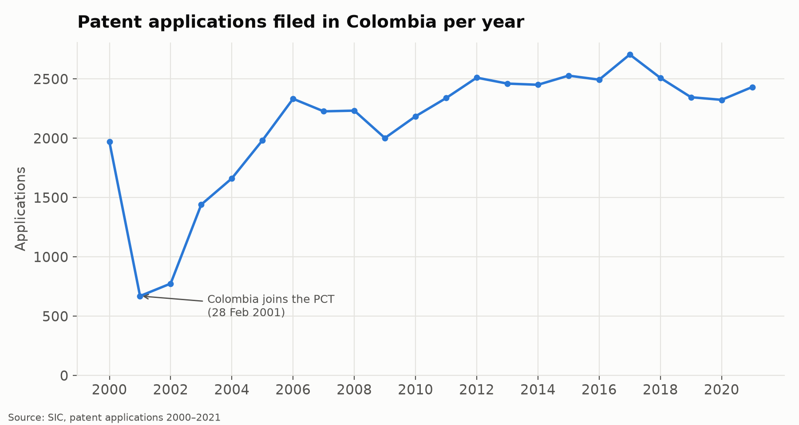
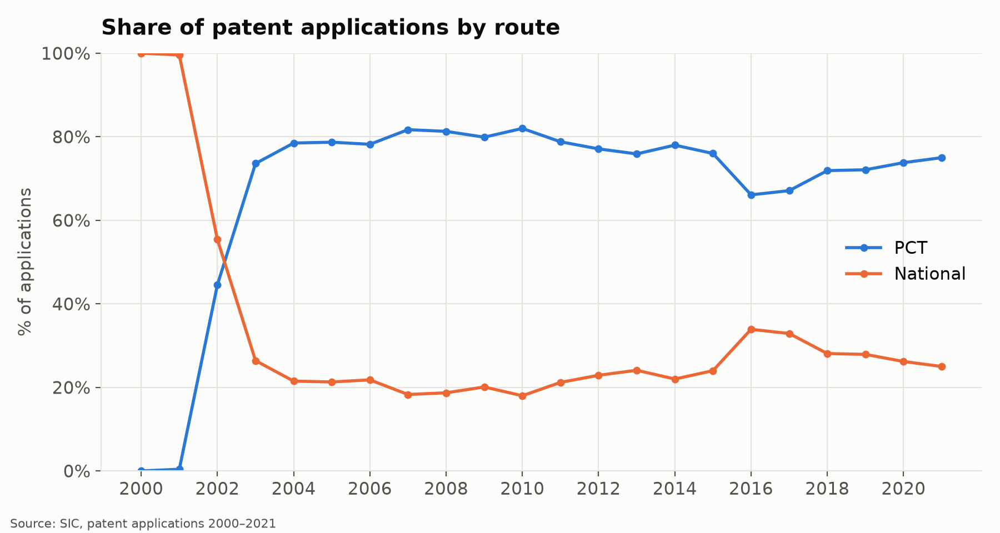
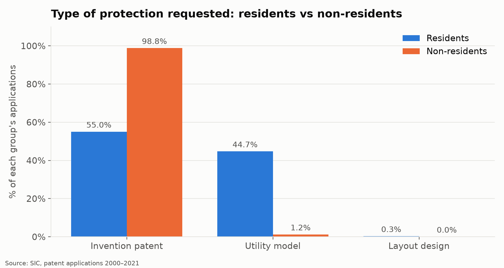
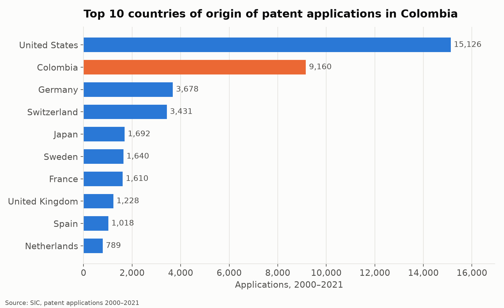
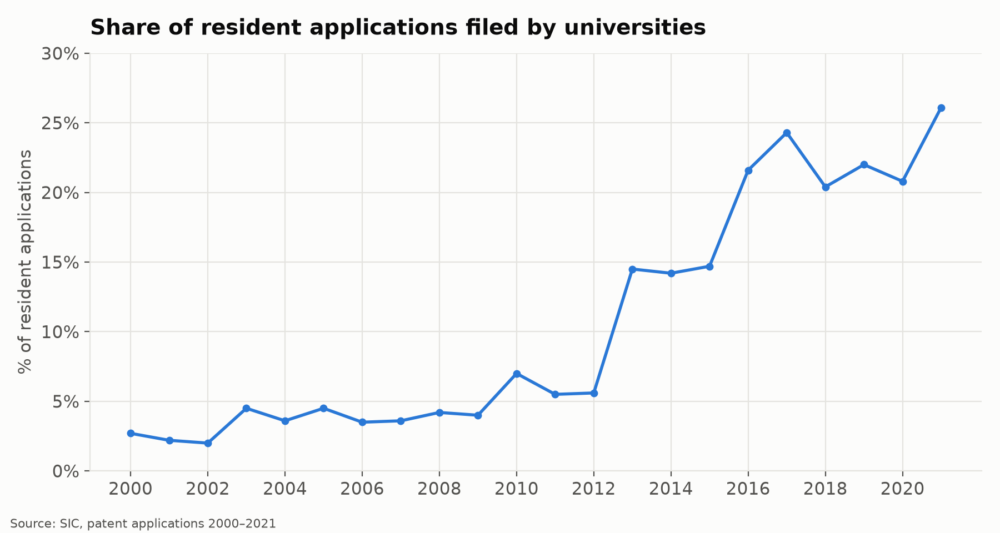
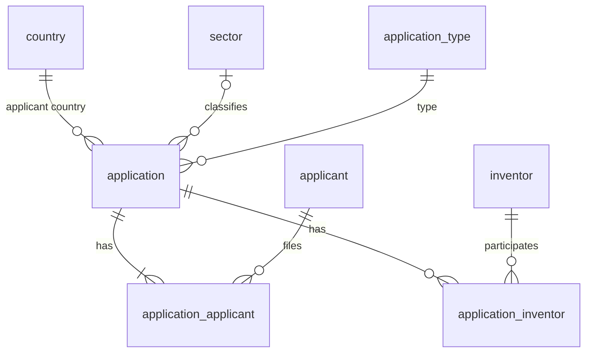

# Patent Applications in Colombia (2000–2021)

**Who files patents in Colombia, in which fields, and how has it changed over two decades?**

An end-to-end data analysis of the **46,582 patent applications** filed at the Superintendencia
de Industria y Comercio (SIC) between 2000 and 2021: from a flat CSV file to a normalized
relational database, and from there to 11 questions answered with **SQL (MySQL)** and
**Python (pandas, matplotlib)** in a Jupyter notebook.

**Full analysis:** [`notebooks/patents_analysis.ipynb`](notebooks/patents_analysis.ipynb)

## Key findings

- **Growth and the PCT.** Applications grew from 670 in 2001 to a peak of 2,706 in 2017. Since
  Colombia joined the Patent Cooperation Treaty (PCT) in 2001, about three out of four
  applications arrive through the PCT route.
- **Most patents come from abroad.** The United States alone filed 40% of foreign applications;
  with Germany and Switzerland, about 60%. Foreign applicants focus on **Chemistry** (66% of
  their filings), led by pharmaceutical companies such as Novartis (770 applications).
- **Two different profiles.** Foreign applicants file almost only invention patents (98.8%),
  while residents split between invention patents (55.0%) and **utility models** (44.7%).
- **Universities are driving local growth.** The share of resident applications rose from about
  13% in the mid-2000s to about 24%, and universities went from 4.0% to 21.6% of resident
  applications.
- **Strong concentration in Bogotá,** which filed 47% of resident applications, almost twice
  its share of national GDP.



| | |
|---|---|
|  |  |
|  |  |

## Questions

| Chapter | Questions |
|---|---|
| **1. Trends over time** | Q1 Applications per year · Q2 PCT vs national route |
| **2. Colombia and the world** | Q3 Share of residents · Q4 Top countries · Q5 Type of protection · Q6 Top cities |
| **3. Sectors and applicants** | Q7 Sectors, residents vs non-residents · Q8 Top applicants · Q9 Role of universities |
| **4. Inventors** | Q10 Inventors per application by sector · Q11 Most prolific inventors |

Each question follows the same workflow: SQL query → result table → chart (when useful) →
written finding.

## Project steps

1. **Normalization:** the original CSV (14 columns, with several inventors or applicants in
   a single cell) is turned into a relational model in third normal form
   (`setup/patentes_a_sql.py`).
2. **Translation:** database, tables, columns and lookup values renamed to English
   (`setup/to_english.py`).
3. **Data quality:** problems found and how they were handled
   ([`docs/data_quality.md`](docs/data_quality.md)).
4. **Analysis:** 11 questions in the Jupyter notebook.

## Data model



| Table | Rows | Content |
|---|---:|---|
| `application` | 46,582 | One row per patent application |
| `applicant` | 16,278 | Companies, universities and individuals who file applications |
| `inventor` | 83,230 | Inventors |
| `application_applicant` | 50,452 | N:M link application ↔ applicant |
| `application_inventor` | 165,859 | N:M link application ↔ inventor |
| `application_type` | 5 | Application type (determines procedure and PCT/national route) |
| `sector` | 5 | Technology sector (the five WIPO sectors) |
| `country` | 100 | Countries |

**Design decisions**
- Cells with several values (`Inventor`, `Solicitante`, separated by `;`) → bridge tables
  with a `list_order` column that keeps the original order.
- Functional dependency `Naturaleza → Trámite, Vía` → lookup table `application_type` (3NF).
- Redundant columns removed: the year (equal to `YEAR(filing_date)` in 100% of rows) and the
  country name (moved to `country`).

**Verification:** the original values of all 46,582 applications (applicants, inventors,
date, country and residence) were rebuilt from the normalized tables and compared with the
CSV: **100% match**, no information lost.

## SQL techniques used

Multi-table `JOIN`s and bridge tables · `LEFT JOIN` with `COALESCE` · conditional aggregation
(`SUM(CASE …)`, `AVG(condition)`) · CTEs · subqueries · window functions
(`SUM(COUNT(*)) OVER ()`) · data-quality checks.

## How to reproduce

```bash
pip install -r requirements.txt
python setup/patentes_a_sql.py Patentes_presentadas.csv patentes.sql
python setup/to_english.py patentes.sql patents.sql
mysql -u <user> -p < patents.sql            # creates the database `patents`
export MYSQL_PASSWORD='your_password'       # the notebook reads it from here
jupyter notebook notebooks/patents_analysis.ipynb
```
The original CSV and the generated `.sql` files are not included in the repository because of
their size.

## Limitations

- The same company may appear under several spellings; names were not merged automatically.
- Inventors with the same name are treated as the same person (no inventor ID in the source).
- Country and residence describe the **first applicant**, not the inventors.
- Universities are identified by name (`LIKE '%UNIVERSI%'`).

## Sources

- Superintendencia de Industria y Comercio (SIC), open data on patent applications.
- DANE, departmental GDP 2024 (used for the comparison in Q6).

**Tools:** MySQL 8, Python 3, pandas, matplotlib, Jupyter, VS Code.

**Author:** César Fernando Ibarguen · [GitHub](https://github.com/cesar-ibarguen)
